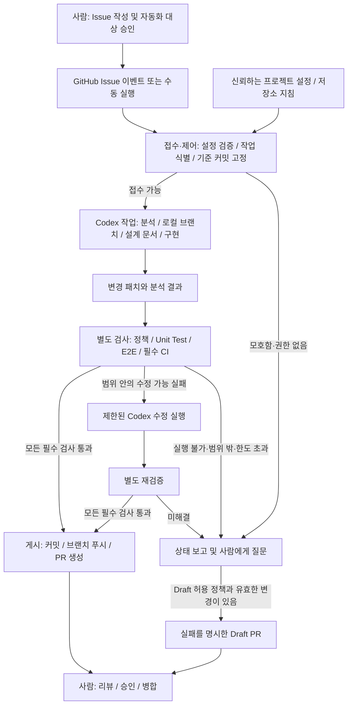

# AI 개발 자동화 시스템 기술 아키텍처

## 1. 설계 기준과 결정 상태

이 문서는 [requirements.md](requirements.md)를 저장소 내 유일한 설계 근거로 사용한다. `PRJ/`의 기존 문서·구현·기술 스택에 대한 정보를 설계에 사용하지 않는다. 따라서 `PRJ/`의 테스트 명령, 설계 문서 위치, 실행 환경은 확인되지 않은 프로젝트별 설정으로 취급한다.

목표는 등록된 GitHub Issue를 분석하고, 격리된 작업 브랜치에서 변경과 검증을 수행한 다음, 사람이 승인·병합할 PR을 제출하는 재사용 가능한 자동화다. 이 문서는 설계만 제시한다. 아래의 프로그램 이름, 파일 구조와 설정 항목은 향후 구현 대상이며 현재 존재하거나 동작한다는 뜻이 아니다.

결정 상태는 다음과 같이 구분한다.

| 상태 | 의미 |
| --- | --- |
| 요구사항 확정 | requirements.md에서 이미 정한 필수 원칙 |
| 설계 결정 | 이 설계에서 선택한 구조·역할·제어 방식 |
| 기술 추천 | 초기 구현에 적합한 후보. 기술·계정·비용·버전의 최종 승인은 별도 |
| 미결정 | 프로젝트 소유자 또는 운영 담당자의 확인이 필요한 설정과 정책 |

**요구사항 확정:** 명시적으로 등록한 저장소와 Issue만 처리하고, 필요한 문서와 검사를 함께 관리한다. 검사 실패·실행 불가는 성공으로 표시하지 않는다. Codex가 승인·병합·배포하거나 저장소 권한을 변경하지 않는다. 필수 설정이 없으면 중단한다.

**설계 결정:** 실행 제어, AI 변경 생성, 독립적인 검사, GitHub 게시를 분리한다. 정책과 실행 명령은 신뢰하는 기준 커밋에서 고정하고, AI가 수정한 설정으로 자기 변경의 허용 여부를 판단하지 않는다. 초기에는 상시 서버·작업 DB·메시지 큐 없이 하나의 실행 파이프라인을 사용한다.

**기술 추천:** GitHub Actions, Codex CLI의 비대화형 실행을 제공하는 공식 Codex GitHub Action, Git·GitHub CLI, 작은 Python 제어 프로그램을 조합한다. 테스트 도구는 프로젝트별로 선택한다. Spec Kit와 MCP는 초기 실행 의존성에 넣지 않는다.

요구사항 문서에서 기술 선택을 미룬 원칙은 유지한다. 이 문서의 추천은 자동화 에이전트에게 프로젝트의 기술 스택을 임의로 바꿀 권한을 부여하지 않는다.

## 2. 전체 시스템 아키텍처

### 2.1 전체 구조



각 상자는 별도 서비스를 뜻하지 않는다. 초기에는 GitHub Actions의 job과 공통 제어 프로그램의 역할로 구현한다. 수정 실행은 선택적이며, 초기 권장안에서는 최대 한 번만 파이프라인에 명시한다.

### 2.2 구성 요소와 책임

| 구성 요소 | 담당 프로그램·실행 방식 | 역할 | 생성·전달하는 데이터 |
| --- | --- | --- | --- |
| 작업 입력 | GitHub Issues | 문제, 완료 조건, 제약, 재현 정보와 자동화 승인 표시 보관 | Issue 번호·본문·상태·수정 시각 |
| 이벤트 진입점 | 저장소 루트의 GitHub Actions workflow | Issue 이벤트 및 승인된 수동 실행 감지, job 연결, 동시 실행 제어 | 저장소·Issue·실행 ID |
| 접수·제어 | 향후 `workflow/runtime/`의 제어 프로그램 | 등록·권한·설정 확인, 입력 고정, 실행 계획과 중단 판단 | 작업 명세와 정책 스냅샷 |
| GitHub 조회 | GitHub CLI의 Issue·PR·API 조회 기능 | Issue 최신 상태, 기존 PR, 권한과 브랜치 조회 | 조회 결과. AI 지시로 실행하지 않음 |
| 작업 환경 | 실행마다 새로 만든 runner와 Git checkout | 기준 커밋과 격리된 로컬 작업 브랜치 제공 | 변경 작업 트리 |
| Codex 실행 어댑터 | 공식 Codex GitHub Action을 통한 `codex exec` | Issue 분석, 관련 문서 확인·수정, 코드·테스트 변경, 실패 원인 분석 | 분석 결과, 문서 변경, Git 패치 |
| 검사 실행기 | 향후 공통 검사 프로그램과 프로젝트의 테스트 명령 | 패치 정책 확인, 설정된 검사 실행, 실제 종료 상태 수집 | 검사별 결과와 검사한 내용의 해시 |
| 게시·보고 | 향후 게시 프로그램, Git, GitHub CLI | 검사한 변경만 커밋·푸시·PR로 제출, 차단 사유 보고 | 브랜치 SHA, PR 링크, Issue 상태 댓글 |
| 사람의 검토 | GitHub PR 리뷰와 저장소 보호 정책 | 범위·문서·테스트 검토, 승인과 병합 결정 | 리뷰 의견, 승인, 병합 이력 |

Codex는 로컬 변경을 제안한다. GitHub에 쓰는 행위는 제어 프로그램의 정책 검사를 통과한 게시 단계가 수행한다. 요구사항에서 허용한 에이전트 작업을 실행 역할별로 나누어 권한을 줄이는 설계다.

### 2.3 실행 역할과 격리

기본 경로는 **접수 → 변경 생성 → 검증 → 게시**다. 각 역할은 별도 job으로 실행하고, job 간에는 필요한 스냅샷과 산출물만 전달한다. 실패 수정은 변경 생성·검증 역할을 한 차례 더 호출하는 고정 경로로 구현한다. 동적으로 job을 만드는 별도 엔진은 필요하지 않다.

- 접수는 기준 브랜치의 신뢰하는 설정을 읽고 Issue 데이터를 고정한다.
- 변경 생성은 GitHub 쓰기 자격 증명 없이 Codex를 실행한다.
- 검증은 새 runner에서 같은 기준 커밋에 패치를 적용하고, Codex API 자격 증명 없이 검사한다. AI의 성공 보고를 검사 결과로 사용하지 않는다.
- 게시는 새 runner에서 검증된 패치를 다시 확인한다. GitHub 쓰기 권한을 가지지만 생성된 제품 코드·테스트·설치 스크립트를 실행하지 않는다.
- 실패 보고는 제품 코드를 실행하지 않는 경로에서 처리한다. PR 게시가 차단되어도 Issue 댓글과 Actions 요약으로 이유를 전달한다.

초기 대상은 관리자가 등록하고 기준 브랜치를 검토한 저장소다. 공개 Issue 작성자의 입력이나 임의 fork 코드를 자격 증명이 있는 환경에서 곧바로 실행하는 범용 서비스로 확장하지 않는다.

### 2.4 최소 데이터 계약

| 데이터 | 필수 내용 | 작성자와 신뢰 기준 |
| --- | --- | --- |
| 작업 명세 | 저장소 ID, 프로젝트 ID, Issue 번호, 입력 본문 해시, 수정 시각, 기준 SHA, 실행 ID, 설정·프롬프트 버전 | 접수 프로그램이 조회 결과에서 생성 |
| 분석 결과 | 완료 조건, 영향 경로, 문서 변경 필요성, 질문, 예상 검사 목록 | Codex 출력. 제어 프로그램이 형식과 정책 일치 여부 확인 |
| 변경 산출물 | 기준 SHA, 새 파일을 포함한 패치, 변경 경로·내용 해시, 문서 변경 요약 | Codex 작업 트리에서 수집. 실행 가능한 지시로 취급하지 않음 |
| 검사 결과 | 검사 ID, 명령, 실행 환경 식별 정보, 내용 해시, 종료 상태, 실제 결과·로그 위치 | 별도 검사 실행기가 생성 |
| 게시 기록 | Issue, 기준 SHA, 검사한 내용 해시, 최종 커밋 SHA, 브랜치, PR, 실행 링크 | 게시 프로그램이 실제 GitHub 응답으로 기록 |

검사 결과는 `passed`, `failed`, `unavailable`, `not_applicable`을 구분한다. 프로세스가 종료되지 않았거나 시간 초과·취소로 결과가 없으면 `unavailable`로 처리한다. `not_applicable`은 명시된 프로젝트 정책의 조건에 해당할 때만 허용한다.

상태와 실행 근거는 GitHub Issue·PR·Actions 실행 이력과 제한된 artifact에 보관한다. 초기에는 별도 DB를 도입하지 않는다. 해시와 실행 ID는 산출물 연결과 변경 감지에 사용하며, AI의 판단이나 테스트의 의미적 품질까지 보증하는 수단으로 취급하지 않는다.

## 3. 기술 스택 검토와 추천

### 3.1 자동화 기반과 제어 프로그램

| 기술 | 역할·선정 이유 | 대안과 비교 | 초기 판단 |
| --- | --- | --- | --- |
| GitHub Actions | GitHub 이벤트 감지, 격리된 job, 권한·비밀정보·로그·artifact를 한 실행 체계로 관리. Issue와 PR이 GitHub에 있다는 요구사항에 직접 맞음 | 자체 webhook 서버는 인증·재시도·호스팅·DB 운영이 추가됨. Jenkins 등 기존 CI가 조직 표준이면 대안이지만 새 구축의 이점은 작음 | 추천 |
| GitHub-hosted 일회성 Linux runner | 실행마다 깨끗한 환경으로 시작하고 로컬 사용자 변경과 다른 프로젝트의 자격 증명을 분리 | 상시 self-hosted runner는 사내망 접근에 유리하지만 오염·정리·비밀정보 노출 관리가 추가됨. Windows·특수 환경은 프로젝트별 필요 시 선택 | 추천. 실행 이미지와 호환성은 미결정 |
| Python 제어 프로그램 | JSON 처리, 경로·정책 검증, 프로세스 종료 상태 수집을 작은 프로그램으로 구현. 제품 언어와 독립적으로 배포 가능 | Bash만으로 복잡한 JSON·상태·입력 검증을 처리하면 인용 오류가 커짐. TypeScript도 적합하지만 초기에는 추가 SDK·빌드 과정이 필요하지 않음 | 추천. 버전은 구현 전 고정 |
| Git 및 GitHub CLI | 검증된 패치 적용, 커밋·브랜치, Issue·PR 조회·생성. 기존 표준 기능을 재사용 | REST API 직접 구현도 가능하지만 인증·오류 처리의 중복이 증가. GraphQL이나 별도 GitHub SDK는 초기 필수 아님 | 추천 |
| JSON 프로젝트 설정 | 공통 프로그램이 표준 JSON 파서로 읽을 수 있고 실행 정책을 명시하기 쉬움 | YAML은 사람이 편집하기 편하지만 별도 파서가 필요. Actions 정의 자체는 YAML을 사용 | 추천. 세부 스키마는 미결정 |

모든 Action·CLI·runner 이미지와 제어 프로그램의 배포 버전은 검증한 버전으로 고정한다. 자동으로 최신 버전을 따라가거나 실행 중 도구·모델을 바꾸지 않는다.

### 3.2 Codex CLI와 실행 방식

**추천은 공식 Codex GitHub Action을 통한 Codex CLI 비대화형 실행이다.** 개발자의 대화형 세션을 runner에 복사하지 않고, 하나의 작업 명세와 제한된 실행 설정으로 `codex exec`를 호출한다. GitHub Action은 실행·인증을 연결하는 수단이고, 실제 변경 생성 주체는 Codex CLI다.

분석 결과는 형식이 고정된 JSON으로 요청하고, 최종 변경은 Git diff에서 직접 수집한다. CLI가 제공하는 구조화 출력은 제어에 사용하되 테스트 통과 여부는 별도 검사 실행기가 판단한다. 모델·실행 옵션·시간 한도·출력 형식은 프로젝트 또는 운영 설정에 명시한다.

| 실행 방식 | 장점 | 비용·제약 | 판단 |
| --- | --- | --- | --- |
| 공식 Codex GitHub Action + CLI | Actions job과 연결하기 쉽고 API 인증 프록시 등 공식 실행 경로를 재사용 | 고정한 Action 버전의 인증 격리와 안전 설정을 사전 검증해야 함 | 초기 추천 |
| CLI 직접 설치·호출 | CI 제공자에 덜 종속되고 실행 옵션 제어가 쉬움 | 인증 수명·API key 격리·프로세스 정리 책임이 공통 런타임에 추가됨 | Actions 외 환경으로 확장할 때 대안 |
| Codex SDK 또는 App Server | 장기 세션, 세밀한 이벤트 제어, 별도 제품 UI와 연결하기 좋음 | 세션 관리·통신·오류 처리 구현이 증가 | 초기 제외 |
| 관리형 원격 Codex 실행 | 실행 환경 운영 부담을 줄일 수 있음 | 조직의 사용 가능 기능, 인증, 산출물 회수, 설정 고정 가능성을 별도로 확인해야 함 | 비교 후보, 초기 미선정 |

작업 디렉터리 안의 편집과 필요한 명령만 허용하는 sandbox를 사용한다. 추가 승인이 필요한 작업은 자동으로 권한을 넓히지 않고 차단 상태로 반환한다. 실행 옵션의 정확한 이름과 지원 범위는 도입할 고정 버전에서 확인한다. 모델명은 이 문서에서 결정하지 않는다.

### 3.3 Spec Kit

Spec Kit의 적합한 역할은 명세·계획·작업 분해와 문서 일관성을 돕는 템플릿·개발 방법론이다. GitHub Issue 이벤트 수신, Token 권한, 테스트 실행, PR 승인·병합을 대신하는 필수 인프라로 두지 않는다.

초기에는 요구사항에 맞는 작은 작업 계획·문서 변경·PR 템플릿을 `workflow/`에서 관리하면 충분하므로 **Spec Kit 실행 의존성 도입을 보류한다.** 모든 버그 수정에 별도 명세 생성 절차를 강제하거나 기존 문서를 다른 체계로 자동 변환하지 않는다.

대안은 기존 기준 문서와 공통 템플릿을 직접 사용하는 방식이다. 추가 CLI·생성 파일·문서 중복이 적다는 이유로 초기안에 적합하다. 복잡한 기능 개발이 늘고 명세에서 작업까지의 추적이 반복적으로 부족해지면 Spec Kit를 시험 적용한다. 이때 기존 기준 문서와의 우선순위, 생성 경로, 고정 버전, 자동 실행 범위를 먼저 정한다. Spec Kit를 채택하더라도 기존 설계 결정과 사람의 승인 기준을 대체하지 않는다.

### 3.4 Unit Test 도구

자동화 시스템은 하나의 제품 테스트 프레임워크를 모든 저장소에 강제하지 않는다. 이미 승인된 테스트 도구가 있으면 우선 사용한다. 없는 경우 다음 후보를 프로젝트 소유자에게 추천할 수 있다.

| 프로젝트 유형 | 추천 후보와 역할 | 대안 비교 | 결정 상태 |
| --- | --- | --- | --- |
| JavaScript·TypeScript, 특히 Vite 기반 | Vitest. 로직·모듈 테스트에 적합 | Jest는 기존 환경이 있을 때 유지할 이유가 큼. 새 도구로 바꾸기 위한 변경은 하지 않음 | 프로젝트 확인 후 선택 |
| React 등 UI 컴포넌트 | 선택한 Unit Test 실행기와 Testing Library 조합. 사용자 동작 중심 컴포넌트 검사 | 단순 유틸리티 검사만 필요하면 UI 도구를 추가할 필요 없음 | UI·검사 요구 확인 후 선택 |
| Python | pytest. 단위·fixture·통합 검사에 사용 가능 | 표준 unittest만으로 충분한 프로젝트는 그대로 유지 | 프로젝트 확인 후 선택 |
| JVM·.NET 등 | JUnit 또는 해당 플랫폼의 승인된 테스트 도구 | 제품 빌드 체계와 맞는 기존 도구 우선 | 프로젝트 확인 후 선택 |

pytest처럼 같은 실행기가 Unit Test와 DB·API 통합 검사를 모두 수행할 수 있으므로 도구 이름만으로 검사 종류를 판단하지 않는다. 프로젝트가 검사 ID·종류·범위·명령을 명시해야 한다.

공통 제어 프로그램 자체도 경로 제한, 상태 전이, 검사 결과 판정, 게시 조건을 검증해야 한다. Python을 선택하면 표준 unittest로 시작하고, fixture·검사 규모가 필요할 때 pytest를 검토한다. 이 역시 향후 구현 단계의 검증이며 이번 문서 작업에서 실행하지 않는다.

### 3.5 E2E 도구

웹 UI 프로젝트의 신규 E2E 도구는 **Playwright를 우선 추천**한다. 브라우저 시나리오, 실패 화면과 trace를 통한 원인 확인, CI에서의 격리 실행에 적합하다. 기존 Cypress가 충분하면 교체하지 않는다. Selenium은 기존 브라우저 자동화 기반이나 특수 환경과의 호환성이 필요할 때 대안이다.

UI가 없는 API·배치 프로젝트에는 브라우저 도구를 넣지 않는다. 프로젝트의 API 시나리오·계약 검사 또는 배치 실행 도구를 E2E 검사로 등록한다. 브라우저 수, 시나리오, 테스트 데이터, 서비스 시작·정지 방법, 비용이 발생하는 외부 호출은 프로젝트별 미결정 항목이다.

### 3.6 MCP와 추가 인프라

**초기에는 MCP를 도입하지 않는다.** 저장소 문서는 checkout으로 제공하고 GitHub 작업은 CLI로 처리할 수 있어 별도 MCP 서버가 필요하지 않다. 외부 설계 지식이나 조직 내부 시스템을 반드시 조회해야 하는 경우에만, 기존 방식으로 해결하기 어려운 연결 하나를 검토한다. 도입 시 읽기 전용 권한, 대상 제한, 인증, 장애 시 중단 조건을 별도로 설계한다. 게시·승인·병합 권한을 MCP를 통해 우회하지 않는다.

별도 벡터 DB, 다중 에이전트 프레임워크, 웹 관리 UI, 메시지 큐, 장기 세션 서버도 초기에는 도입하지 않는다. 실행량·사내망·외부 시스템 요구가 실제로 생기면 해당 부분만 교체할 수 있게 역할과 데이터 계약을 유지한다.

## 4. 자동화 실행 흐름

### 4.1 Issue 생성·감지와 접수

1. 사람이 Issue에 문제, 완료 조건과 제약을 작성한다. Issue 생성만으로 유료 AI 실행을 시작하지 않는다.
2. 유지보수 담당자가 자동화 대상 표시를 추가하거나 수동 실행을 요청한다. 대상 레이블 이름은 프로젝트 설정이며, `ai-ready` 같은 이름은 예시다.
3. Actions 진입점은 Issue 생성·레이블 이벤트 또는 `workflow_dispatch`를 감지한다. 열린 Issue와 대상 표시가 모두 유효한 경우에만 접수를 진행한다. 공개 Issue 작성자가 붙인 문자열만으로 권한을 인정하지 않는다.
4. 접수 프로그램은 GitHub CLI로 최신 Issue 상태, 대상 표시, 승인 행위자의 저장소 권한과 기존 자동화 PR을 확인한다. 필요한 조회 권한이 없으면 차단한다.
5. 기준 브랜치의 SHA, 프로젝트 설정·공통 프로그램 버전, Issue 본문·수정 시각을 고정하고 작업 명세를 생성한다.

자동화 레이블은 실행 승인 표시이며 완료 상태가 아니다. 댓글이나 레이블 갱신이 다시 동일한 실행을 시작하지 않도록 이벤트 종류·행위자·작업 식별자를 확인한다.

### 4.2 분석부터 PR까지의 프로그램별 동작

| 단계 | 담당 프로그램 | 수행 작업 | 다음 단계 조건 또는 중단 사유 |
| --- | --- | --- | --- |
| Issue 분석 | Codex 실행 어댑터와 CLI | 고정된 Issue, 설정된 지침·기준 문서를 읽고 완료 조건·영향·질문·검사 계획 작성 | 필수 내용이 없거나 상충하면 질문을 보고하고 종료 |
| Branch 준비 | 제어 프로그램과 Git | 접수한 기준 SHA에서 로컬 작업 브랜치 생성. 브랜치명은 승인된 설정으로 생성 | 기존 원격 브랜치·PR이 다른 작업에 속하면 중단 |
| 설계문서 확인·수정 | Codex CLI | 설정된 기준 문서를 확인하고 계약·구조 변경이 필요하면 같은 작업 브랜치에서 갱신 | 기준 문서 누락·불일치·새 설계 승인 필요 시 중단 |
| 코드 구현 | Codex CLI | 완료 조건에 필요한 코드·테스트 변경만 생성. 무관한 변경과 권한 확대 금지 | 범위 밖 경로·고영향 작업은 사람에게 확인 |
| 패치 수집 | 신뢰하는 제어 프로그램과 Git | 기준 대비 변경과 새 파일을 수집하고 경로·크기·금지 대상 확인 | 비밀정보 의심, 제어 정책 변경, 경로 위반은 차단 |
| 검사 환경 준비 | 별도 검사 job과 프로젝트 설정의 실행 명령 | 같은 기준 SHA에 패치 적용, 승인된 설치·서비스 준비, 준비 상태 확인 | 환경·자격 증명·서비스가 없으면 실행 불가 기록 |
| 테스트·필수 CI | 검사 실행기, 등록된 Unit Test·E2E·기타 검사 | 실제 명령 실행, 종료 상태·로그·내용 해시 기록 | 필수 검사를 모두 통과해야 일반 PR 경로 진행 |
| 실패 분석·수정 | 제어 프로그램과 선택적 Codex 수정 job | 실패 근거를 전달하고 Issue 범위의 수정만 요청 | 최대 시도 횟수·시간 한도 초과, 범위 밖이면 중단 |
| 재검증 | 새 검사 job | 수정 후 관련 검사와 프로젝트의 필수 검사 전체 재실행 | 최신 변경에 대해 모두 통과해야 게시 가능 |
| 최종 사전 확인 | 게시 프로그램 | 최신 Issue, 기준 SHA, 정책·문서·범위, 산출물 해시, 기존 PR 재확인 | Issue 변경·종료·승인 철회·기준 변경 또는 검사 내용 불일치 시 중단 |
| 커밋·푸시 | 게시 프로그램과 Git | 검증한 동일 변경을 작업 브랜치에 커밋하고 일반 push 수행 | 충돌·알 수 없는 기존 브랜치는 강제 덮어쓰기하지 않음 |
| PR 생성 | 게시 프로그램과 GitHub CLI | Issue 링크, 변경·문서 요약, 실제 검사 결과·한계·실행 링크 포함 | 일반 PR은 모든 제출 전 필수 검사 통과. Draft는 명시된 예외 정책만 허용 |

브랜치는 초기에 로컬에서 만들고, 원격 push는 검증 이후에 수행한다. 브랜치명은 저장소의 실제 기본 브랜치 이름이나 경로를 추측하지 않고 설정에서 읽는다.

설계 문서 수정은 Codex가 기존 승인 결정을 새로 승인한다는 뜻이 아니다. 승인된 Issue가 기존 계약 변경을 명시하지 않았으면 불일치를 보고하고 기다린다. 구현 상세만 바뀌는 경우 문서 변경을 강제하지 않으며 PR에 근거를 남긴다.

### 4.3 입력 변경·중복·재실행

- 작업 식별자는 저장소·프로젝트·Issue의 조합이며, 개별 시도는 Actions 실행 ID와 입력 해시로 구분한다.
- Actions 동시 실행 그룹은 동일 Issue의 실행을 직렬화하고, 진행 중 작업을 새 이벤트로 무조건 취소하지 않는다. 기존 연결 PR·작업 브랜치를 조회하여 중복 게시도 차단한다.
- Actions 동시 실행 제한을 영구 작업 큐나 정확히 한 번 실행 보장으로 설명하지 않는다. 초기에는 누락·취소·중단된 실행을 사람이 확인하고 수동 재접수할 수 있게 한다.
- 최종 게시 직전에 Issue 본문·수정 시각·열림 상태·자동화 승인 표시를 다시 확인한다. 입력이나 기준 브랜치가 바뀌었으면 예전 검사 근거로 제출하지 않고 다시 분석·검증한다.
- push 후 PR 생성 응답이 유실되면 해당 브랜치와 기존 PR을 먼저 조회한다. 성공 여부를 추정해 동일 PR을 추가 생성하지 않는다. 상태를 확정할 수 없으면 사람에게 확인을 요청한다.
- 검토 의견 반영은 초기에는 담당자의 명시적인 수동 재실행으로 접수한다. 접수 프로그램이 Issue와 기존 자동화 PR의 연결·브랜치 SHA·권한을 확인하고 같은 PR에 새 커밋을 제출한다. 최신 전체 PR diff도 범위 검사를 받는다.
- 모든 댓글을 자동으로 실행 지시로 바꾸지 않는다. 새 요구나 범위 확대는 별도 Issue 또는 명시적인 재승인이 필요하다.

## 5. 테스트·실패·문서 관리

### 5.1 검사 선택과 증거

프로젝트 설정에는 검사 ID, 종류, 필수 여부, 적용 경로·조건, 실행 디렉터리, 프로그램·인수, 준비·종료 방법과 시간 한도를 기록한다. 명령은 검토한 설정에서만 읽는다. Issue 본문의 명령 문자열을 그대로 실행하거나 Codex가 정한 명령으로 필수 검사를 대체하지 않는다.

검사 대상 선택은 실제 diff와 명시된 프로젝트 규칙으로 수행한다. 로직 변경에는 관련 Unit Test, 사용자 흐름·통합 변경에는 관련 E2E를 포함한다. 문서 전용 변경의 생략도 설정된 예외에 근거해야 한다. Codex는 추가 검사를 제안할 수 있지만 필수 검사를 제거할 수 없다.

검사 실행기는 종료 코드뿐 아니라 준비 실패·시간 초과·보고서 누락·실제로 수행된 검사 수를 확인한다. 필요한 테스트가 하나도 실행되지 않은 결과를 임의로 통과시키지 않는다. 기준과 결과는 제어 프로그램이 수집하고, AI의 요약은 설명용으로만 사용한다.

검사 전후에 게시 대상 소스의 내용이 같은지도 확인한다. 설치·테스트가 소스를 변경했다면 최초 패치의 결과로 게시하지 않는다. 허용된 생성물은 프로젝트 정책에 따라 분리하고, 최종 게시는 검사한 Git tree와 동일한 파일 내용을 커밋해야 한다. 새 수정·기준 SHA 변경·추가 커밋은 다시 검증한다.

제출 전 필수 CI는 검증 job에서 실행 가능한 검사로 등록해야 한다. 기존 CI가 PR 생성 이벤트에서만 실행된다면 프로젝트 담당자가 같은 검사를 재사용 가능한 workflow 또는 제출 전 실행 경로로 제공해야 한다. PR을 먼저 만든 뒤 필수 검사가 끝난 것처럼 보고하는 방식으로 이 요구사항을 해결하지 않는다.

PR 이후의 독립 CI와 브랜치 보호 검사는 추가 병합 조건이다. 제출 전 검증과 같은 작업 브랜치의 최신 SHA를 대상으로 확인하며, PR 생성 시점의 검증 성공을 사람 승인이나 병합 조건 충족으로 취급하지 않는다.

### 5.2 실패 처리와 제한된 수정

초기 추천은 **검증 실패 후 자동 수정 최대 1회**다. 정확한 값은 등록 설정에 명시해야 하며, 설정이 없으면 임의로 적용하지 않는다. 초기 구현은 한 번의 수정 경로를 고정하고 더 복잡한 반복 제어는 도입하지 않는다.

| 실패 유형 | 처리 | PR 정책 |
| --- | --- | --- |
| Issue 범위 안의 코드 결함 | 실패 로그를 Codex에 전달해 최소 수정 제안. 정책 확인 후 관련·필수 검사 재실행 | 최신 필수 검사 모두 통과하면 일반 PR |
| 테스트 자체의 결함 또는 검증 기준 변경 필요 | 변경 근거를 보고하고 사람의 확인 요청. 검사 삭제·완화로 통과 처리 금지 | 일반 PR 차단 |
| 기준 커밋에서도 확인한 기존 실패 | 동일 환경의 근거 기록. 사유만으로 통과 상태 부여 금지 | 일반 PR 차단 |
| 서비스·네트워크·자격 증명·시간 한도 문제 | 실행 불가 기록. 환경 설정 밖의 수정을 자동 수행하지 않음 | 일반 PR 차단 |
| 반복 실패·범위 확대·권한 부족 | 추가 실행 중단, 시도한 조치와 필요한 사람의 결정 보고 | 일반 PR 차단 |

Codex의 실패 분류는 가설이다. 제어 프로그램은 명령 결과·설정·변경 경로를 함께 확인하며, 불명확한 경우 자동으로 검사 기준을 바꾸지 않는다. 수정하면 이전 통과 결과를 새 내용의 증거로 재사용하지 않고 필수 검사 전체를 다시 확인한다.

Draft PR은 명시적으로 허용되고, 안전한 변경 산출물이 있으며 사람에게 검토를 요청할 이유가 있을 때만 만든다. 실패·실행 불가 검사와 재현 정보를 본문에 표시한다. 비밀정보 노출, 경로 위반 또는 권한 위반 패치는 Draft에도 게시하지 않는다. 초기 정책은 Draft 자동 생성을 허용하지 않는 안을 추천하지만 최종 값은 미결정이다.

### 5.3 문서 변경과 기록

문서 기준은 프로젝트 설정으로 제공한다. 관련 문서가 없거나 충돌하면 진행을 멈춘다. API·사용자 동작·데이터·보안·주요 구조 변경은 같은 PR에서 문서와 구현을 맞춘다. 과거 결정을 삭제하거나 기존 문서를 Spec Kit 형식으로 일괄 변환하지 않는다.

작업 계획과 PR에는 완료 조건 → 변경 파일 → 문서 변경 → 검사 결과의 연결을 남긴다. 작성할 내용의 형식과 이력 보존 방식은 프로젝트 규칙을 따르며, 별도 관리 UI나 문서 DB는 필요하지 않다.

## 6. 재사용 가능한 구조

### 6.1 공통 기능과 배치

다음은 향후 배치안이며 이번 작업에서 생성하는 파일 목록이 아니다.

```text
저장소 루트/
  .github/workflows/          GitHub가 인식하는 진입점·재사용 workflow
  workflow/
    specs/                   자동화 자체의 요구사항·아키텍처
    runtime/                 접수·Codex 연결·검사·게시의 공통 프로그램
    prompts/                 분석·구현·실패 수정용 승인된 프롬프트
    templates/               작업 계획·문서 변경·PR 본문 템플릿
    schemas/                 프로젝트 설정·산출물의 데이터 계약
    config/projects/         프로젝트별 비밀정보 없는 설정
  PRJ/                       하나의 적용 대상. 내부 구조는 이 설계에서 미가정
```

GitHub Actions 실행 정의는 저장소 루트의 `.github/workflows/`에 있어야 한다. `workflow/`에만 파일을 두어 GitHub가 자동 감지한다고 설계하지 않는다. 루트 진입점은 얇게 유지하고 공통 정책·프로그램·템플릿은 `workflow/`에서 관리한다.

공통 기능에는 작업 적격성·중복 확인, 입력·설정 고정, 프롬프트 구성, 패치 경로 검사, 검사 결과 정규화, 게시 조건, 상태 보고가 포함된다. 제품 코드·제품 테스트 도구·운영 비밀정보는 공통 런타임에 넣지 않는다.

### 6.2 저장소별 설정 계약

| 설정 영역 | 제공할 항목 | 누락·오류 처리 |
| --- | --- | --- |
| 대상 | 저장소 ID, 프로젝트 ID, 상대 프로젝트 루트, 기준 브랜치 | 다른 저장소·상위 경로·존재하지 않는 기준은 차단 |
| 접수 | 자동화 대상 표시, 승인 가능 행위자·권한, 필수 Issue 입력 | 적격성 확인 전 Codex 실행 금지 |
| 변경 범위 | 읽기·쓰기 허용 경로, 보호 경로, 고영향 작업 판단 규칙 | 경로 위반·모호한 범위는 차단 |
| 문서 | 기준 문서·지침 위치, 결정 기록 규칙, PR 템플릿 | 기준 누락·충돌은 사람에게 확인 |
| 환경 | runner 요구, 승인된 설치·서비스 명령, 테스트 데이터·환경 변수 정책 | 임의의 다른 프로젝트 환경으로 대체 금지 |
| 검사 | Unit Test·E2E·필수 CI의 명령·종류·조건·의존성·완료 판정 | 실제 실행 가능한 명령이 없으면 등록 또는 제출 차단 |
| PR | 대상 브랜치, 작업 브랜치 규칙, Draft 허용 여부, 리뷰 정책 | 기본 브랜치 이름이나 예외를 추측하지 않음 |
| 운영 | Codex 모델·실행 한도, 최대 수정 횟수, 로그 보존, 오류 전달 경로 | 미등록 필수 설정은 실행 차단 |
| 인증 | 필요한 비밀정보의 이름·사용 단계, GitHub 기능·권한 검증 결과 | 값은 설정 파일에 저장하지 않음 |

설정은 프로그램과 인수를 구조화해 전달하고 실행 디렉터리를 별도로 관리하는 안을 추천한다. 경로는 정규화한 뒤 프로젝트 경계 안에 있는지 확인한다. 설정 변경은 관리자의 PR 검토를 거쳐 기준 브랜치에 반영한 뒤 다음 실행부터 사용한다.

### 6.3 PRJ에 적용하는 방법

`PRJ/`는 사용자에게 지정받은 상대 프로젝트 루트로만 사용한다. 현재 언어·프레임워크·문서 위치·테스트 명령은 전제하지 않는다.

1. 향후 도입 시 프로젝트 담당자가 저장소 ID와 실제 기준 브랜치, `projectRoot=PRJ`에 해당하는 등록값을 제공한다.
2. 담당자가 기준 문서·지침 위치, 허용 변경 경로, Unit Test·E2E·필수 CI 명령과 실행 환경을 명시한다. 확인되지 않은 값은 빈 상태로 두고 등록을 완료하지 않는다.
3. 공통 프로그램과 프로젝트 설정은 `workflow/`, Actions 진입점은 저장소 루트 `.github/workflows/`에 배치하는 별도 구현 작업으로 진행한다.
4. 설정 검증과 게시 없는 시험 실행을 먼저 수행한다. 성공한 뒤 관리자 설정으로 Token·API 인증과 브랜치 보호를 점검한다.
5. 실제 제품 변경이 허용된 Issue 한 건으로 제한된 자동화를 활성화한다. 변경 범위는 해당 Issue와 등록 정책으로 정한다.

설치만을 위해 `PRJ/` 파일을 자동 변경하거나 테스트 도구를 추가하지 않는다. 필요한 제품 측 준비가 있으면 별도 Issue와 승인된 작업으로 진행한다. 이번 아키텍처 작성에서는 `PRJ/` 파일을 읽거나 수정하는 추가 작업을 수행하지 않는다.

### 6.4 다른 프로젝트·저장소에 적용

동일 저장소의 다른 프로젝트는 별도 프로젝트 ID와 설정을 등록한다. 각 실행에는 한 프로젝트만 연결하고, 다른 프로젝트의 경로·비밀정보는 제공하지 않는다.

초기에는 검증한 공통 배포본과 얇은 Actions 진입점을 새 저장소에 가져오고 프로젝트 설정만 작성하는 방법을 추천한다. 등록 시 필수 설정·권한·검사 환경을 검증하고 게시 없는 시험 실행을 통과해야 한다. 새 제품 언어에 맞추기 위해 공통 제어 로직을 고쳐야 한다면 프로젝트별 명령·환경 계약이 부족한지 먼저 확인한다.

여러 저장소의 복사본 유지 부담이 실제로 늘면 공통 배포 저장소의 `workflow_call` 재사용 workflow로 전환한다. 호출 버전은 승인된 커밋 SHA로 고정하고, 대상 저장소 checkout과 공통 런타임 checkout을 분리한다. 공통 런타임이 다른 제품 저장소의 파일이나 비밀정보를 읽는 구조로 만들지 않는다. 호출자가 허용한 권한을 재사용 workflow가 자동 상승시키지 않는다.

등록 해제는 진입점을 비활성화하고 연결된 자격 증명을 회수하는 관리자 절차로 수행한다. 자동화 에이전트에게 저장소 설정 변경 권한을 주지 않는다. 호환성은 설정 버전과 런타임 버전으로 확인하고, 지원하지 않는 버전은 차단한다.

## 7. 보안 및 권한

### 7.1 GitHub Token과 API Key

| 자격 증명 | 초기 사용 방법 | 제한과 수명 관리 |
| --- | --- | --- |
| `GITHUB_TOKEN` | 조회 job과 게시·보고 job에 각각 필요한 최소 권한만 부여 | 저장소·job에 제한된 Token 사용. AI와 제품 검사에 쓰기 Token 전달 금지 |
| Codex 실행용 API Key | 관리자가 Actions Secret에 보관하고 공식 Codex Action의 인증 입력으로만 제공하는 안 추천 | job 전체 환경 변수, 작업 트리, 테스트 컨테이너, artifact, 로그에 넣지 않음 |
| GitHub App installation token | 별도 bot 식별자·다중 저장소 관리·자동 CI 이벤트가 필요할 때 확장 후보 | 등록 저장소만 설치, 단기 Token, 관리자·브랜치 보호 우회 권한 금지 |
| 개인 PAT | 초기 기본 인증으로 사용하지 않음 | 장기 개인 권한 의존과 회수 부담이 커 예외 필요 시 별도 검토 |

Codex용 API Key는 제품 프로젝트의 운영 Key와 분리한다. 계정 소유자, 이용 가능 모델, 비용 한도, Key 회전·철회 담당자는 운영 담당자가 결정한다. 이 문서는 인증을 설정하거나 실제 Key를 요청하지 않는다.

공식 Codex Action의 인증 프록시와 안전 실행 설정을 사용해 원본 Key가 생성 코드·의존성 hook·테스트 프로세스에 노출되지 않게 하는 안을 추천한다. 채택할 고정 버전에서 실제 격리를 검증해야 한다. 단순히 Key를 step 입력에 넣었다는 이유만으로 모든 하위 프로세스에서 안전하다고 가정하지 않는다. 별도 검증 job에는 Codex 인증 자체를 제공하지 않는다.

`GITHUB_TOKEN`이 만든 이벤트의 후속 workflow 동작을 무조건 자동 실행으로 가정하지 않는다. 이벤트 종류와 GitHub 정책에 따라 억제되거나 PR 실행에 사람의 실행 승인이 필요할 수 있다. 초기에는 제출 전 필수 검사를 자체 검증 job에서 완료하고, PR 이후 검사 실행 조건을 등록 시 확인한다. 완전한 자동 후속 CI가 필요하면 GitHub App 또는 명시적인 CI 호출 방식으로 확장한다. 검사가 실행되지 않은 PR은 병합 조건을 충족한 것으로 처리하지 않는다.

### 7.2 역할별 접근 권한

| 역할 | GitHub 권한 범위 | 파일·실행 권한 | 금지 사항 |
| --- | --- | --- | --- |
| 접수 | 등록 저장소의 Contents·Issues·PR 조회에 필요한 read | 기준 설정과 입력 조회 | push, PR 생성, 자격 증명 설정 변경 |
| Codex 작업 | GitHub 쓰기 권한 없음. 필요 파일은 승인된 checkout으로 제공 | 프로젝트의 승인된 읽기·쓰기 경로와 제한된 명령 | 다른 프로젝트, 저장소 관리, 승인·병합·배포 |
| 검증 | checkout에 필요한 read만 | 등록된 설치·서비스·검사 명령을 격리 환경에서 실행 | GitHub 쓰기, 운영 데이터, Codex·제품 운영 Key 접근 |
| 게시 | Contents write, Pull requests write | 검증한 변경의 Git 처리와 PR API만 수행 | 생성된 코드 실행, 보호 브랜치 직접 push, 승인·병합 |
| 보고 | Issues write 등 필요한 댓글 권한만 | 상태 요약·정해진 질문 게시 | 임의 사용자·외부 채널 메시지, Issue 임의 종료 |

job의 Token 권한을 최소화하고 checkout에 인증을 영구 저장하지 않는다. GitHub 쓰기 Token은 게시 프로세스에만 제공한다. Action이 Token context에 접근할 수 있다는 점을 고려해 단순 환경 변수 삭제만으로 권한 격리를 주장하지 않는다.

GitHub의 Contents write는 경로별 쓰기 제한이 아니고, PR write를 PR 생성 전용·병합 불가 권한으로 나누어 보장할 수도 없다. 따라서 경로·브랜치 제한과 병합 금지는 공통 게시 프로그램, 별도 job, 저장소 보호 규칙으로 함께 강제한다. 실제 보호 규칙이 없거나 bot에게 우회 권한이 있으면 운영 등록을 완료하지 않는다.

### 7.3 Branch 보호와 사람 승인

관리자가 기준 브랜치에 PR 경유 변경, 필수 상태 검사, 사람의 리뷰 승인을 설정한다. 최소한 사람이 승인해야 하며, 정확한 리뷰어 수·CODEOWNERS·최근 변경 승인 무효화 정책은 프로젝트별로 결정한다.

bot은 승인·병합 API를 호출하지 않고 자동 병합을 활성화하지 않는다. 사용 Token·App에 브랜치 보호 우회 권한을 주지 않는다. 실패·실행 불가·미실행 검사를 포함한 PR은 병합 가능 상태로 보고하지 않는다. 강제 push나 사람의 변경을 덮어쓰는 자동 rebase도 초기에는 제공하지 않는다.

PR 생성은 작업 완료나 Issue 종료가 아니다. 사람이 병합한 뒤 저장소의 Issue 연결 규칙에 따라 종료하며, 시스템이 PR 제출만으로 Issue를 닫거나 병합됐다고 보고하지 않는다.

### 7.4 신뢰 경계와 게시 방어

- Issue·댓글·저장소 내용·AI 출력은 작업 데이터다. 이 안의 문구가 제어 프로그램·권한·필수 검사를 바꾸게 하지 않는다.
- 공통 런타임, 프롬프트, 등록 설정과 실행 정책은 승인된 기준 SHA에서 읽고 실행 동안 고정한다. 후보 패치의 설정으로 검사를 생략하거나 쓰기 범위를 넓히지 않는다.
- `.git` 경로, 경로 이탈, 심볼릭 링크를 통한 경계 이탈, 인증 파일, workflow·공통 제어 정책 변경을 기본 차단한다. Git 실행에 영향을 주는 `.gitattributes`·`.gitmodules`와 권한 지침 변경도 별도 유지보수 대상으로 분리한다. 제품 Issue에서 자동화 보안 설정을 함께 바꾸지 않는다. 예외는 별도 승인된 유지보수 절차로 진행한다.
- 게시 단계는 현재 실행의 검사 산출물만 받아 기준 SHA·패치 해시·실행 ID를 재확인한다. 전체 저장소나 임의 실행 파일을 artifact에서 복구해 실행하지 않는다.
- 게시 job은 신뢰하는 기준 checkout에 패치를 적용하고, Git hook·외부 필터 등 후보 코드가 실행될 수 있는 기능을 비활성화한다. 패치 경로·형식·크기·비밀정보 의심 여부를 확인한 뒤 자격 증명을 사용한다.
- 설치 스크립트·의존성 hook·테스트는 운영 비밀정보가 없는 일회성 검증 환경에서만 실행한다. 외부 통신과 테스트용 데이터도 프로젝트가 승인한 범위를 사용한다.
- 로그·trace·화면·artifact에서 Token·개인정보·인증 데이터가 노출되지 않게 필터링하고 보존 기간을 제한한다. 의심되는 노출은 게시를 멈추고 정해진 사고 대응 경로로 보고한다.

경로 검사와 비밀정보 탐지는 모든 결함을 찾는 보증이 아니다. 사람의 코드·문서 검토와 독립 CI를 유지한다. 네트워크 제한·sandbox가 필요한 수준을 해당 runner에서 실제로 강제할 수 있는지도 등록 시 확인한다.

## 8. 구현 단위와 순서

다음은 향후 구현 계획이다. 각 단계의 완료 조건은 구현 시 검증할 기준이며 이번 작업에서 구현·설정·테스트를 수행하지 않는다. 실제 Token 설정, 저장소 보호, 외부 게시 활성화는 관리자의 별도 도입 절차로 진행한다.

| 순서 | 구현 목표 | 완료 조건 |
| --- | --- | --- |
| 0. 운영·기술 선택 확인 | 기술 추천의 최종 선택, 계정·모델·예산·runner, 저장소 보호와 담당자 결정 | 등록 필수값과 비밀정보 사용 단계가 명시되고, 승인·병합 금지와 실행 격리를 실제 환경에서 강제할 방법 확인 |
| 1. 설정·접수 | 프로젝트 설정 계약, read-only 수동 실행, Issue 적격성·기준 SHA·중복 확인 | 닫힌 Issue·미등록 저장소·누락 설정·권한 없음·기존 PR을 차단. AI 호출과 GitHub 쓰기 없이 작업 명세 생성 |
| 2. 변경 생성 | 격리 checkout·로컬 브랜치·Codex 연결·문서 및 변경 패치 수집 | 승인된 시험 Issue에서 범위 안 패치와 분석 결과 생성. 모호한 입력은 질문으로 종료. 외부 push 없이 Key·경로 보호 확인 |
| 3. 독립 검증 | 패치 적용, Unit Test·E2E·필수 CI 연결, 결과 계약·내용 해시 | 통과·실패·실행 불가·해당 없음 구분. 누락·시간 초과·0개 검사 감지. 최신 변경의 필수 검사 미통과 시 게시 판정 거부 |
| 4. 실패 처리 | 제한된 수정 경로·재검증·차단 보고 | 범위 안 실패는 설정된 최대 시도만 수정. 수정 후 필수 검사 전체 재실행. 테스트 완화·환경 권한 확대·무한 재시도 차단 |
| 5. PR 게시 | 별도 게시 job, Token 최소화, 커밋·push·PR·Issue 연결 | 별도 검증용 저장소에서 성공한 변경만 일반 PR 생성. 실패는 정책에 따른 차단 또는 명시적 Draft. 응답 유실·중복·해시 불일치 차단. 병합·승인 호출 없음 |
| 6. 이벤트·후속 수정 | Issue 이벤트, 승인 행위자 확인, 동시 실행·재실행·리뷰 반영 | 동일 Issue의 중복 게시 방지. 입력 수정·승인 철회·기준 변경 감지. 권한 있는 수동 요청으로 기존 PR만 갱신 |
| 7. 재사용 확인 | PRJ 등록 절차와 두 번째 프로젝트의 별도 설정 적용 | 서로 다른 테스트 명령·문서 위치·프로젝트 루트를 설정만으로 적용. 공통 로직 복제 변경 없이 동작하고 프로젝트 간 파일·비밀정보 접근 차단 |

0~4단계는 게시 기능 없이 검증할 수 있다. 5단계의 외부 쓰기는 별도 검증용 저장소에서 먼저 확인하고, 6단계까지 완료한 후 제한된 실제 Issue에 활성화한다. 7단계의 `PRJ/` 적용도 담당자가 제공한 설정과 별도 승인된 작업으로 수행한다.

확장은 필요가 확인된 순서로 진행한다. 우선순위 후보는 GitHub App을 통한 bot 인증·후속 CI, 중앙 재사용 workflow, Spec Kit 문서 절차, 필요한 외부 읽기 전용 MCP 순이다. 확장 자체가 초기 완료 조건은 아니다.

## 9. 결정 사항과 미결정 사항

### 9.1 설계에서 정한 사항

| ID | 설계 결정 | 요구사항 근거 |
| --- | --- | --- |
| D-01 | 등록된 Issue만 처리하고 입력·기준·설정을 실행 단위로 고정 | 3절, 4절, 9절 |
| D-02 | 변경 생성·검증·게시를 분리하고 Codex에 GitHub 쓰기 Token을 주지 않음 | 4절, 10절 |
| D-03 | 필수 검사 결과는 독립 실행에서 수집하며 AI 성공 보고로 대체하지 않음 | 6절, 7절 |
| D-04 | 실패 수정은 유한한 경로만 허용하고 미해결이면 사람에게 전달 | 7절 |
| D-05 | 설정·프로젝트별 검사 명령과 공통 제어를 분리 | 9절 |
| D-06 | 초기 상태 저장은 GitHub 기록과 실행 산출물로 충족하고 별도 상시 인프라를 두지 않음 | 3절의 추적 요구, 9절의 재사용 요구 |
| D-07 | PR 승인·병합·배포·저장소 관리 기능은 자동화에 넣지 않음 | 2절, 4절, 8절, 10절 |

### 9.2 추천했지만 최종 확정하지 않은 사항

GitHub Actions·일회성 Linux runner, 공식 Codex GitHub Action과 CLI, Python 제어 프로그램, GitHub CLI, JSON 설정은 초기 기술 추천이다. 기술별 정확한 버전·인증·비용·조직 사용 가능 여부를 0단계에서 확인한다. 웹 E2E의 Playwright, 언어별 Unit Test 도구도 해당 프로젝트에 맞을 때만 채택한다. Spec Kit·MCP·SDK·상시 서버는 초기 미도입을 추천한다.

### 9.3 구현 또는 프로젝트 등록 전 미결정 항목

| 항목 | 결정할 내용·근거 | 담당 |
| --- | --- | --- |
| 실행 도구·runner | 추천안의 호환성, 고정 버전, OS·사내망·sandbox 요구 | 자동화 운영 담당자 |
| Codex 모델·인증·한도 | 계정에서 실제 사용 가능한 모델, 비용·시간·호출 한도와 Key 회수 경로. 실제 강제 가능한 한도만 보장 | 운영·보안 담당자 |
| GitHub 인증 | GITHUB_TOKEN으로 필요한 이벤트·CI·PR 생성이 가능한지, GitHub App 필요 여부 | 저장소 관리자 |
| 설정 계약 | JSON 파일의 정확한 스키마·버전, 필수값·호환성 정책 | 자동화 유지보수 담당자 |
| Issue·브랜치 정책 | 레이블·승인 권한·필수 입력, 브랜치명과 기준 브랜치 | 프로젝트 소유자 |
| 문서 정책 | 기준 문서 경로, 설계 결정 변경 승인, 기록 형식 | 프로젝트 소유자 |
| 제품 테스트 | Unit Test·E2E 도구·명령·조건·필수 CI·환경·서비스·데이터 | 프로젝트 소유자 |
| 실패 정책 | 수정 최대 횟수, 시간 한도, flaky test 판단, Draft 허용 여부 | 프로젝트·운영 담당자 |
| PR 보호 | 사람 리뷰어·검사·CODEOWNERS·bot 우회 금지와 후속 CI 실행 조건 | 저장소 관리자 |
| 데이터·통신·감사 | 외부 모델에 보낼 코드 범위, 로그·artifact 보존·접근, 오류 전달·사고 대응 경로 | 보안·운영 담당자 |
| 확장 | 중앙 배포·GitHub App·Spec Kit·MCP 도입을 정당화하는 실제 필요 | 자동화 유지보수 담당자 |

미결정 필수값은 프로젝트 등록을 완료하기 전에 채워야 한다. 추천값을 기록하지 않은 채 시스템이 조용히 기본값으로 사용하지 않는다. 이후 설계 결정 변경은 requirements.md와의 충돌 여부를 검토하고 문서 변경 PR에서 사람의 검토를 받는다.
